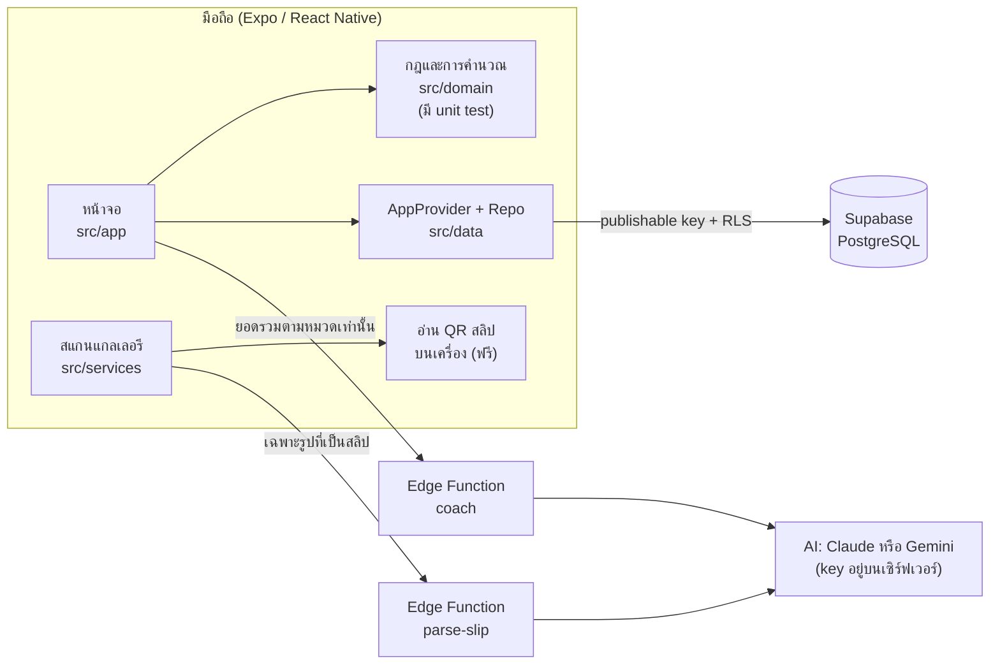

# MyPay

แอปการเงินส่วนตัวสำหรับนักศึกษาและ First Jobber ที่ไม่ได้แค่ "จดว่าใช้ไปเท่าไร" แต่บอกว่า **เงินที่มีจะพอใช้อีกกี่วัน** และช่วยคิด **ก่อน** จ่าย

รายวิชา Introduction to Software Engineering (15031001) · ทีม 13. Socrates and Skeletons

MyPay แยกออกมาเป็นแอปของตัวเองจาก "MindPay ใหม่" (branch `v2` ของ repo [Socrates-and-Skeletons-](https://github.com/2550expo-tech/Socrates-and-Skeletons-)) เมื่อ 25 ต.ค. 2569 ประวัติ commit ก่อนหน้านั้นมาจาก repo เดิม MindPay ตัวเดิมอยู่ที่ repo เดิมและไม่เปลี่ยน

---

## ลองใช้

| ที่ไหน | ลิงก์ |
|---|---|
| 💻 เว็บ (คอม / iPhone / มือถือทุกรุ่น) | https://2550expo-tech.github.io/mypay/ |
| 🤖 แอป Android (.apk) ชื่อ "MyPay" | https://github.com/2550expo-tech/mypay/releases/tag/latest-apk |

ทั้งสองอัปเดตอัตโนมัติทุกครั้งที่ push ขึ้น `main` (บน iPhone เปิดลิงก์เว็บใน Safari → แชร์ → เพิ่มไปยังหน้าจอโฮม)
เวอร์ชันเว็บทำได้ทุกอย่าง ยกเว้นการสแกนทั้งแกลเลอรี (ใช้ "เลือกรูปสลิป" แทน)

### MyPay กับ MindPay

| | MyPay (repo นี้) | MindPay (repo เดิม) |
|---|---|---|
| Android package | `com.socratesandskeletons.mypay` (ลงคู่กับ MindPay ได้) | `com.socratesandskeletons.mindpay` และ `.mindpay.v2` |
| ลิงก์ในแอป | `mypay://` | `mindpay://`, `mindpay-v2://` |
| เว็บ | `/mypay/` | `/Socrates-and-Skeletons-/` |
| ข้อมูลในเครื่อง | ของตัวเอง (key `mypay.*`, ล็อกอินบนเว็บแยกกัน) | ของตัวเอง |
| Supabase | **โปรเจคเดียวกัน**: บัญชีและข้อมูลเดียวกัน (ลบบัญชีใน MyPay = ข้อมูลใน MindPay หายด้วย) | |
| อัปเดต OTA | ปิดไว้ (ยังไม่มี EAS project ของตัวเอง) อัปเดตด้วย APK ใหม่ | channel `production` |

**ทีมต้องตั้งใน Supabase → Authentication → URL Configuration → Redirect URLs** เพิ่ม `https://2550expo-tech.github.io/mypay/**` และ `mypay://**` ไม่อย่างนั้นลิงก์ในอีเมล (ยืนยัน/ตั้งรหัสใหม่) จะเปิดหน้าเว็บ MindPay แทน (บัญชียังยืนยันได้ เพราะเป็นบัญชีเดียวกัน และ MyPay ใช้รหัส 6 หลักจากอีเมลได้อยู่แล้ว)

ถ้าจะเปิดอัปเดต OTA: เจ้าของบัญชี Expo รัน `npx eas-cli@latest init` ใน repo นี้ (ได้ projectId ใหม่ของ MyPay) แล้วใส่ `updates.url` ใน `app.json` และ `EXPO_TOKEN` ใน GitHub Secrets ของ repo นี้

## Functional Requirements (5 ข้อตาม M1 Team Charter + FR-3 เสียง)

แถบล่างของ MyPay: **หน้าหลัก · รายการ · (+) · สถิติ · โค้ช** ตรงกลางคือ **Quick Access**: ปุ่ม (+) เปิดแผ่น "เพิ่มรายการ" รวมทุกทางที่ใช้เพิ่มเงินเข้า/ออก และยอดที่ใช้ไปวันนี้อยู่ข้าง ๆ ทุกหน้า (แตะเพื่อดูรายการ) บนแอป Android มี **วิดเจ็ตหน้าจอโฮม** แบบเดียวกัน: ยอดวันนี้ เงินพอใช้กี่วัน และปุ่มลัด เลือกสลิป / พูด / + (ตั้งค่า → วิดเจ็ตหน้าจอโฮม หรือกดค้างที่หน้าจอโฮม → วิดเจ็ต → MyPay)

| FR | ฟีเจอร์ | ในแอป MyPay |
|---|---|---|
| FR-1 | Transaction Management: เพิ่ม แก้ จัดหมวด ลบ | แท็บ **รายการ** (ค้นหา, ชิปกรอง รายจ่าย/รายรับ/หมวด, แยกตามวันพร้อมยอดสุทธิของวัน) · (+) → **กรอกรายจ่ายเอง** / **เพิ่มเงินเข้า** |
| FR-2 | Overview Dashboard: รายรับ รายจ่าย ยอดคงเหลือ ยอดตามหมวด | **หน้าหลัก**: เงินพอใช้กี่วันเทียบสิ้นเดือน ยอดคงเหลือ งบเดือนนี้และงบวันนี้ รายการล่าสุด · แท็บ **สถิติ**: ใช้จ่ายรวม เงินเข้า สุทธิ เฉลี่ยต่อวันของช่วง วงกลมตามหมวด และกราฟตามช่วงที่เลือก (รายวัน/รายเดือน) |
| FR-3 | Voice Entry: พูด "ข้าว 50 บาท" แล้วจดให้ (หลายรายการในประโยคเดียว, รายรับ, เมื่อวาน) | (+) → **พูดรายการ** |
| FR-4 | Automatic Gallery Slip Detection: ตรวจสลิปในแกลเลอรี, เกณฑ์ความมั่นใจ 80%, กันรายการซ้ำ | **อัตโนมัติทุกครั้งที่เปิดแอป (เฉพาะสลิปของวันนั้น)** + ปุ่ม **ดึงสลิปวันนี้** บนการ์ดเงิน + (+) → **เลือกสลิปจากแกลเลอรี** สำหรับสลิปวันก่อน ๆ; สำเนารูปสลิปเก็บไว้ในเครื่องเท่านั้น แตะรายการเพื่อดูรูป |
| FR-5 | AI Coach **น้องกล้า**: มาสคอตตัวใหญ่ ขยับปากและท่าทางเวลาพูด พูดออกเสียงด้วยน้ำเสียงสุขุม เป็นมิตร และอธิบายข้อมูลที่ยืนยันแล้ว (แทนโค้ช 3 โทนเดิม ตามที่ผู้ใช้ขอ 29 ก.ย.) | แท็บ **โค้ช** |
| FR-6 | Money Runway: ประมาณวันที่เงินจะแตะเส้นสำรองจากค่าเฉลี่ย 7 วัน | การ์ดเงินบน **หน้าหลัก**: "เงินพอใช้อีก N วัน" เทียบกับสิ้นเดือน (เหลือเก็บได้อีก / ขาดอีกกี่วัน) แตะการ์ดเพื่อเปิดหน้า Money Runway เต็ม |

การเชื่อมโยง FR → โค้ด → เทสต์ ทั้งหมดอยู่ใน [`docs/TRACEABILITY.md`](docs/TRACEABILITY.md)

## สถาปัตยกรรม



- **เงินเก็บเป็นสตางค์ (จำนวนเต็ม)** ไม่มีปัญหาทศนิยมเพี้ยน
- **เวลาอิงเวลาไทย (UTC+7)** ทุกจุด ทั้งการจัดกลุ่มรายวันและการอ่านวันที่บนสลิป
- **สลิปที่อ่านได้เป็น "แบบร่าง"** จนกว่าผู้ใช้จะยืนยัน ไม่เข้ายอดเงินก่อน
- **API key ของ AI (Claude หรือ Gemini) อยู่บนเซิร์ฟเวอร์เท่านั้น** แอปไม่มีคีย์ลับ

## โครงสร้างโฟลเดอร์

```
src/
  app/            หน้าจอ (Expo Router: ไฟล์ = หน้า)
    (tabs)/       หน้าหลัก, รายการ, สถิติ, โค้ช (แถบล่างวาดเองใน _layout.tsx พร้อมปุ่ม + ตรงกลาง)
    add.tsx       แผ่น "เพิ่มรายการ" ของปุ่ม + (สลิป / พูด / กรอกเอง / เงินเข้า)
  widget/         วิดเจ็ตหน้าจอโฮม Android (react-native-android-widget) ลงทะเบียนใน index.ts
    runway.tsx    FR-6 Money Runway เต็มหน้า (เปิดจากการ์ดเงินบนหน้าหลัก)
    scan.tsx      FR-4 สแกนสลิป
    transaction.tsx  FR-1 เพิ่ม/แก้/ลบ/ตรวจแบบร่าง
  domain/         กฎทั้งหมด (pure TypeScript ไม่มี UI) + __tests__
  data/           Supabase client, Repo (cloud / demo), AppProvider
  services/       แกลเลอรี, อ่านสลิป, โค้ช
  ui/             Design system: theme, components, charts, ต้นไม้เงิน (สรุปกฎใน docs/DESIGN_SYSTEM.md)
supabase/
  migrations/     SQL สร้างตาราง + RLS
  functions/      parse-slip, coach (Deno)
docs/             Traceability, AI usage log, Design System
```

---

## เริ่มใช้งาน

### สิ่งที่ต้องมี
- Node.js 22 ขึ้นไป
- มือถือ Android (แนะนำ) หรือ iPhone
- บัญชี Expo (ฟรี) ถ้าจะ build ไฟล์ .apk

### 1. ติดตั้ง

```bash
git clone https://github.com/2550expo-tech/mypay.git
cd mypay
npm install
cp .env.example .env
```

ไฟล์ `.env.example` มีค่า Supabase ของโปรเจคทีมใส่ไว้แล้ว (เป็นคีย์สาธารณะ ปลอดภัยที่จะอยู่ในแอป เพราะฐานข้อมูลใช้ RLS กันไว้)

### 2. ทดลองเร็วที่สุด: Expo Go (สำหรับทีมพัฒนา)

Expo Go เป็นแอปตัวช่วยตอนเขียนโค้ด แอปของเราจะรันอยู่ข้างใน Expo Go จึงเห็นชื่อ Expo Go บนมือถือ ถ้าต้องการแอป **MindPay** ที่มีไอคอนและชื่อของตัวเอง ใช้ข้อ 3

1. ลงแอป **Expo Go** จาก Play Store / App Store
2. รัน `npx expo start` แล้วสแกน QR ที่ขึ้นใน terminal ด้วย Expo Go
3. เข้าแอปได้ 2 แบบ: **สมัครสมาชิก** (ใช้ข้อมูลจริงบน Supabase) หรือ **ลองใช้ด้วยข้อมูลตัวอย่าง** (ข้อมูลอยู่ในเครื่อง)

> Android บน Expo Go อาจเข้าถึงแกลเลอรีได้ไม่เต็มที่ตามนโยบายของ Google ถ้าสแกนแกลเลอรีไม่เจอรูป ให้ใช้ปุ่ม "เลือกรูปเอง" หรือ build ไฟล์ .apk ตามข้อ 3

### 3. ติดตั้งเป็นแอป MyPay จริงบน Android (.apk)

**วิธีง่ายสุด: ดาวน์โหลดไฟล์ที่ build ไว้แล้ว**
ทุกครั้งที่ push ขึ้น `main` GitHub จะ build APK ให้อัตโนมัติ (ไฟล์ `.github/workflows/android-apk.yml`) ใช้เวลาประมาณ 15–25 นาที
เปิดหน้านี้บนมือถือ Android → แตะ `mypay.apk` → ติดตั้ง:
https://github.com/2550expo-tech/mypay/releases/tag/latest-apk

ไฟล์นี้เซ็นด้วย debug key ใช้ทดสอบและพรีเซนต์ได้ แต่ยังไม่ใช่เวอร์ชันลง Play Store

**หรือ build เองผ่าน EAS (บัญชี Expo)**

```bash
npx eas-cli@latest login
npx eas-cli@latest build --profile preview --platform android
```

รอประมาณ 10–20 นาที EAS จะให้ลิงก์ดาวน์โหลด `.apk` เปิดบนมือถือเพื่อติดตั้งได้เลย (ไม่ต้องมีบัญชีนักพัฒนา Google) ได้แอปชื่อ **MyPay** พร้อมไอคอนต้นไม้เงิน (EAS Build ต้องมี EAS project ของ MyPay ก่อน: `npx eas-cli@latest init`)

ไอคอนสร้างจาก `scripts/make_icons.py` ถ้ามีไฟล์โลโก้ทางการของทีม แทนที่ไฟล์ใน `assets/` ได้เลย (icon.png 1024×1024 ไม่มีพื้นใส)

### อัปเดตแอปที่ติดตั้งแล้ว (EAS Update)

ตอนนี้ **ปิดอยู่** (`app.json` → `updates.enabled: false`) เพราะ MyPay ยังไม่มีโปรเจค Expo ของตัวเอง อัปเดตด้วยการลง APK ใหม่จาก release `latest-apk`
ถ้าจะเปิด: เจ้าของบัญชี Expo รัน `npx eas-cli@latest init` (ได้โปรเจค `@expokler/mypay`), ตั้ง `updates.url` และ `runtimeVersion` ใน `app.json`, ใส่ secret `EXPO_TOKEN` ใน GitHub ของ repo นี้ แล้วเพิ่ม workflow ที่รัน `eas update --channel production`

### 4. ตั้งค่า AI (อ่านสลิป + โค้ช)

Supabase Dashboard → **Edge Functions → Secrets** → เพิ่ม **อย่างใดอย่างหนึ่ง** (ใส่ทั้งสองได้ ระบบจะใช้ Claude ก่อน):

| Name | Value | หมายเหตุ |
|---|---|---|
| `GEMINI_API_KEY` (หรือ `GOOGLE_API_KEY`) | คีย์จาก https://aistudio.google.com/apikey · ชื่อต้องตรงเป๊ะ ตัวพิมพ์ใหญ่ ใส่ใน **Edge Functions → Secrets** (ไม่ใช่ Vault หรือหน้า API keys ของ Supabase) | **ฟรี ไม่ต้องใช้บัตร** แต่แบบฟรี Google อาจนำข้อมูลที่ส่งไป (รูปสลิป) ไปปรับปรุงโมเดล และมีเพดานจำนวนครั้งต่อนาที/ต่อวัน เหมาะกับการทดสอบและพรีเซนต์ |
| `ANTHROPIC_API_KEY` | คีย์จาก console.anthropic.com (`sk-ant-...`) | ต้องเติมเครดิตและยืนยันตัวตน ข้อมูลไม่ถูกนำไปฝึกโมเดล |

ไม่ต้อง deploy ใหม่หลังใส่ key

ตัวเลือกเสริม:
- `AI_PROVIDER` = `claude` หรือ `gemini` บังคับใช้ตัวใดตัวหนึ่ง
- `GEMINI_MODEL` (ค่าเริ่มต้น `gemini-3.5-flash-lite` ถ้ารุ่นนี้ใช้ไม่ได้ ระบบลองรุ่นถัดไปเอง)
- `SLIP_MODEL`, `COACH_MODEL` สำหรับ Claude (ค่าเริ่มต้น `claude-haiku-4-5-20251001`)
- `SLIP_DAILY_LIMIT` (300 ใบ/วัน/คน), `COACH_DAILY_LIMIT` (60 ครั้ง/วัน/คน)

ค่าใช้จ่ายโดยประมาณ: Gemini แบบฟรี 0 บาท (ภายในเพดาน) · Claude อ่านสลิป 1 ใบ ≈ 0.003 ดอลลาร์ (ราว 10 สตางค์)
ถ้า AI ตอบไม่ทัน (เกินเพดานแบบฟรี) แอปจะแจ้งให้ลองใหม่ และสลิปที่เหลือจะอ่านต่อตอนเปิดแอปครั้งหน้า

---

### 5. ตั้งค่าการสมัคร / เข้าสู่ระบบ

ตั้ง Site URL, Redirect URLs และเลือกว่าจะให้ยืนยันอีเมลไหม ดูขั้นตอนและเทมเพลตอีเมล (รหัส 6 หลัก) ใน [docs/SUPABASE_AUTH_SETUP.md](docs/SUPABASE_AUTH_SETUP.md)

> อีเมลฟรีของ Supabase ส่งได้เฉพาะอีเมลของสมาชิกทีมในโปรเจค และชั่วโมงละ 2 ฉบับ ช่วงเรียน/พรีเซนต์แนะนำให้ปิด Confirm email

---

## คำสั่งสำหรับนักพัฒนา

```bash
npm test            # unit test 224 เคส: กฎทั้งหมด, ความอ่านง่ายของสีทุกธีม, และผู้ใช้ไม่สุจริตกับ RLS จริง (migration รันใน PGlite ไม่ต้องต่อเน็ต)
npm run e2e:web     # ทดสอบในเบราว์เซอร์ 183 ข้อ: สมัคร/เข้าสู่ระบบ, ขอความยินยอมก่อนส่งสลิปให้ AI (ไม่ยินยอม/ถอน = ส่ง 0 รูป, คำตอบตามบัญชีไปเครื่องใหม่), ลบบัญชี, สแกนสลิปเองตอนเปิดแอป (แกลเลอรีจำลอง), สแกนสลิป, รูปสลิปในเครื่อง, สลิปรอตรวจ, ปุ่ม + และยอดวันนี้ (Quick Access), แผ่นเพิ่มรายการ, จด/แก้/ลบรายการ, เพิ่มเงินเข้า, พูดจด (ตัวฟังเสียงจำลอง), หน้าหลัก 3 ส่วน, ค้นหา/กรองรายการ, สถิติ, เช็กก่อนจ่าย, โค้ชน้องกล้า, ตู้สกินและภารกิจ, ธีมสี, ธีมฮาโลวีน (จับผี/ลูกอม/สกิน), ข้ามเที่ยงคืน, แอนิเมชัน (ครั้งแรก: npx playwright install chromium)
npm run demo:video  # อัดวิดีโอเดโม (สมัคร → ตั้งค่าเงิน → สลิปถูกอ่านเองตอนเปิดแอปแบบ Android → หน้าหลัก → Money Runway → สถิติ → โค้ช) โหมดสว่าง/มืด + แบบเว็บ ลงโฟลเดอร์ demo-video/ ใช้ข้อมูลจำลอง ไม่แตะบัญชีจริง (รัน e2e:web ก่อนเพื่อสร้าง dist/)
npm run typecheck   # ตรวจ TypeScript
npx expo lint       # ESLint
npx expo start      # เปิด dev server
```

### แอนิเมชันและเอฟเฟกต์ (`src/ui/effects.tsx`)

ของที่มี: ค่อย ๆ โผล่ทีละส่วน (`Reveal`), ปุ่ม/การ์ดเด้งตอนกด (`usePressSpring`), แสงวิ่งผ่านการ์ดทอง (`Shine`), ประกายดาว (`Sparkles`), วงแหวนกระเพื่อม (`PulseRing`), แท่งกราฟโต (`GrowBar`), จุดพิมพ์ของโค้ช (`TypingDots`), แสงสแกนสลิป (`ScanBeam`) และพลุเหรียญทอง/ใบไม้ (`useCelebrate`) ตอนสมัครสำเร็จ ตั้งค่าเสร็จ สแกนเจอสลิป และยืนยันสลิป

หลังปรับ UX/UI (13 ต.ค.) ใช้เอฟเฟกต์เท่าที่มีความหมาย: ค่อย ๆ โผล่เฉพาะ 6 วินาทีแรกหลังเปิดแอป, ตัวเลขนับขึ้นเฉพาะตอนค่าเปลี่ยน, พลุเฉพาะเหตุการณ์สำคัญ, (+) กระเพื่อมเฉพาะตอนสแกนสลิป; แสงวิ่ง/ประกายเหลือที่หน้าเปิดแอป เหรียญ และสรุปเดือน; ออโรร่ากับลายเส้นพื้นหลังเอาออก (ใช้ลายจุดนิ่ง `DotGrid` แทน)

กติกาที่ทุกเอฟเฟกต์ต้องทำตาม:
- ขยับเฉพาะ transform กับ opacity และใช้ native driver บนมือถือ จึงลื่นแม้มือถือราคาประหยัด
- ทุกเอฟเฟกต์หยุดเอง ไม่มีอะไรขยับค้างตอนผู้ใช้ไม่ได้ทำอะไร (ประหยัดแบต) มีทดสอบในเบราว์เซอร์ตรวจว่าหน้าหลักนิ่งภายใน 9 วินาที ยกเว้นตอนกำลังสแกน และน้องกล้าตัวใหญ่ (หน้าโค้ช ตู้สกิน หน้าต้อนรับ) ที่หายใจ/กะพริบตาเบา ๆ เฉพาะตอนเปิดหน้านั้นอยู่ (ขยับด้วย transform บน native driver จึงกินแบตน้อย)
- ถ้าเปิด "ลดการเคลื่อนไหว" (Reduce motion) ในมือถือ ทุกอย่างแสดงทันทีโดยไม่เคลื่อนไหว
- ไม่ใช้ native module ใหม่ (ใช้ Animated, react-native-svg, expo-linear-gradient ที่มีอยู่แล้ว) แอปที่ติดตั้งแล้วจึงรับอัปเดต OTA ได้โดยไม่ต้องลง APK ใหม่

### พูดจด (FR-3) และแอปที่ติดตั้งไว้แล้ว

การฟังเสียงในแอปใช้ `expo-speech-recognition` ซึ่งเป็น native module ใหม่ จึงต้องลง APK ใหม่ (release `latest-apk`) ถึงจะแตะไมค์แล้วพูดได้ แอปรุ่นเก่าที่ได้อัปเดต OTA จะเห็นหน้าเดียวกันแต่เป็นช่องพิมพ์ (กดไมค์บนคีย์บอร์ดแล้วพูดก็ได้) เพราะโค้ดโหลด module แบบไม่บังคับ (`requireOptionalNativeModule`) จึงไม่ crash บนเว็บใช้ Web Speech API ของเบราว์เซอร์ (Chrome/Edge/Safari)

### น้องกล้า: โค้ชที่พูดได้ สกิน และภารกิจการเงิน

- **โค้ช** (`src/app/(tabs)/coach.tsx`): น้องกล้าตัวใหญ่บนเวที วาดด้วยโค้ดแบบมีแสงเงา (`src/ui/kla/art.tsx`) แยกเป็นชิ้น (ตัว แขน หัว ตา ปาก) แต่ละชิ้นหมุนรอบข้อต่อของตัวเองด้วย native driver จึงลื่น: หายใจ โยกตัว กะพริบตา เอียงหัว และตอนพูดปากขยับตามพยางค์ มือชี้อธิบาย หัวพยักเบา ๆ (`src/ui/kla/KlaStage.tsx`) ท่าทางเคลื่อนไหวเฉพาะตอนหน้าโค้ชเปิดอยู่ และหยุดเมื่อเปิด "ลดการเคลื่อนไหว"
- **เสียง** (`src/ui/kla/useKlaTalk.ts`, `src/services/tts.ts`, `tts.web.ts`): คำตอบถูกตัดเป็นซับไตเติลสั้น ๆ (`src/domain/klaTalk.ts`) แล้วอ่านทีละท่อนด้วยเสียงภาษาไทยของมือถือ (Google/Apple) หรือเบราว์เซอร์ ช้าและต่ำลงเล็กน้อยให้ฟังสุขุม เป็นมิตร ปิดเสียงได้ที่หน้าโค้ชหรือหน้าตั้งค่า ถ้าเครื่องไม่มีเสียงภาษาไทย น้องกล้ายังขยับปากพร้อมซับไตเติลตามเวลาอ่าน
- **เสียงบน Android ต้องลง APK ใหม่** เพราะใช้ `expo-speech` (native module ใหม่) แอปรุ่นเก่าที่ได้ OTA จะเห็นน้องกล้าพูดเป็นซับไตเติลโดยไม่มีเสียง (โหลด module แบบไม่บังคับ จึงไม่ crash)
- **ตู้สกิน** (`src/app/skins.tsx`, กฎใน `src/domain/skins.ts`): 19 ชุด ได้จากภารกิจการเงิน 8 ภารกิจในหน้าความสำเร็จ (`src/domain/missions.ts` เช่น เปิดแอปติดต่อกัน 30 วัน → ชุดไทย) และสกินลิมิเต็ดที่แจกเฉพาะช่วงเวลา พ้นช่วงแล้วขึ้นว่า "สกินลิมิเต็ด · หมดเวลาแล้ว หาไม่ได้อีก" ชุดที่เลือกใส่แสดงทุกที่ที่มีน้องกล้า ข้อมูลตู้สกินและวันที่เปิดแอปเก็บในเครื่อง (`src/services/kla.ts`)
- **ธีมฮาโลวีน "Spooky Night"** (`src/ui/halloween.tsx`, กฎใน `src/domain/halloween.ts`): เลือกได้ในตั้งค่า → ธีมสี (หรือแตะ "เปิดธีมฮาโลวีน" บนการ์ดเชิญที่หน้าหลักช่วง 29 ก.ย.–2 พ.ย. 2569) โทนม่วงมืดกับส้มฟักทอง มีธงผีห้อยบนหน้าหลัก ค้างคาวบินผ่านการ์ดยอดเงิน ผีน้อยโผล่มุมหัวหน้าจอทุกหน้า และพลุเปลี่ยนเป็นสีฮาโลวีน **จับผีรับลูกอม**: วันละ 3 ตัว ตัวละ 1 เม็ด และได้เพิ่มวันละ 2 เม็ดในวันที่จดรายการ (นับวันละครั้ง จดหลายรายการก็ได้ 2 เม็ดเท่าเดิม จึงไม่จูงใจให้จดเล่น ๆ) ลูกอมปลดล็อก **สกินลิมิเต็ดฮาโลวีน 6 ชุด**: ผีหัวฟักทอง (ฟรีช่วงงาน), ผีน้อยผ้าขาว 5, แม่มดน้อย 12, มัมมี่ 20, แวมไพร์ 30, แฟรงเกนสไตน์ 40 เม็ด พ้น 2 พ.ย. แล้วชุดที่ยังไม่ได้จะหาไม่ได้อีก (ชุดที่ได้แล้วอยู่ตลอด) น้องกล้าทักแบบหลอน ๆ น่ารักที่หน้าโค้ชเมื่อเปิดธีมนี้ ทุกเอฟเฟกต์ขยับไม่กี่รอบแล้วหยุด และหยุดทั้งหมดเมื่อเปิด "ลดการเคลื่อนไหว"
- **Design System**: ค่าสี ตัวอักษร ระยะ มุม และชิ้นส่วนทั้งหมดสรุปไว้ใน [`docs/DESIGN_SYSTEM.md`](docs/DESIGN_SYSTEM.md) พร้อมเช็กลิสต์ก่อนเพิ่มหน้าจอใหม่ ถ่ายภาพหน้าจอธีมไหนก็ได้ด้วย `node scripts/theme-shot.mjs <path> 0 <ชื่อ> dark <ธีม>`
- **ทุกหน้าตามธีม**: ปุ่ม ชิป แถบเมนู การ์ด แถบข้อความแจ้งเตือน และแอนิเมชันเปิดแอปบนเว็บใช้สีของธีมที่เลือก (ไม่มีสีเขียวค้างในธีมอื่น) และมี unit test ตรวจว่าตัวหนังสือทุกธีมอ่านง่ายตามเกณฑ์ WCAG AA (4.5:1) ทั้งโหมดสว่างและมืด แนวทางออกแบบอ้างอิงงานวิจัย UX ที่บันทึกใน `docs/AI_USAGE_LOG.md` แถว 19
- **ไอคอนและหน้าปก**: `node scripts/kla-icons/make.mjs && python3 scripts/kla-icons/finish.py` วาดไอคอนแอป, adaptive icon (รวมแบบสีเดียวของ Android 13), splash และไอคอนเว็บจากภาพน้องกล้าชุดเดียวกับในแอป ไอคอน/splash ของแอปมือถือเปลี่ยนเมื่อลง APK ใหม่ ส่วนแอนิเมชันเปิดแอปและหน้าต้อนรับเปลี่ยนทันทีผ่าน OTA

## ตั้ง Supabase ใหม่ (ถ้าย้ายโปรเจค)

1. สร้างโปรเจคใหม่ (Region: Singapore)
2. SQL Editor → รันไฟล์ใน `supabase/migrations/` ตามลำดับชื่อไฟล์
3. Deploy ฟังก์ชัน: `npx supabase functions deploy parse-slip`, `coach` และ `delete-account`
4. ใส่ Secret `GEMINI_API_KEY` หรือ `ANTHROPIC_API_KEY`
5. แก้ URL และ publishable key ใน `.env` และ `eas.json`

---

## ความปลอดภัยและความเป็นส่วนตัว

- ทุกตาราง (รวม `savings_goals` ที่เพิ่ม 29 ก.ย.) เปิด **Row Level Security** ผู้ใช้เห็นและแก้ได้เฉพาะแถวของตัวเอง ตรวจด้วย Supabase Security Advisor แล้ว ไม่มีปัญหาเรื่องตาราง (เหลือคำแนะนำเดียวคือเปิด Leaked Password Protection ในการตั้งค่า Auth ซึ่งทีมเปิดเองได้)
- รูปในแกลเลอรีตรวจ **บนมือถือก่อน** เฉพาะรูปที่มี QR ของสลิปธนาคาร (หรือรูปขนาดหน้าจอที่มี QR แบบ e-wallet) จึงถูกส่งไปอ่าน และไม่ถูกเก็บไว้บนเซิร์ฟเวอร์ของเรา (ผู้ให้บริการ AI ได้รับรูปเพื่ออ่าน: ถ้าใช้ Gemini แบบฟรี Google อาจเก็บไปปรับปรุงโมเดล ควรใช้แบบเสียเงินหรือ Claude เมื่อมีผู้ใช้จริง)
- **สำเนารูปสลิป**: หลังอ่านและบันทึกสลิปแล้ว รูปย่อที่อ่าน (กว้างราว 1100 px) เก็บเป็นสำเนาในเครื่องนั้นเท่านั้น: แอปมือถือในโฟลเดอร์ของแอป (`expo-file-system`, แยกตามบัญชี ตั้งชื่อตาม hash ของรูป), เว็บใน IndexedDB ของเบราว์เซอร์ ไม่ได้อัปโหลดเก็บบน server แตะรายการที่จดจากสลิปเพื่อดูรูป ลบรายการแล้วสำเนาหายตามหลังพ้นเวลากดเลิกทำ ลบทั้งหมดได้ในตั้งค่า (`src/services/slipCopies.ts`)
- **ขอความยินยอมก่อนส่งรูปสลิปให้ AI** (PDPA): ไม่ส่งรูปใดเลยจนกว่าบัญชีนั้นยินยอม คำตอบเก็บทั้งในเครื่องและกับบัญชี (ตาราง `consents` แบบเพิ่มได้อย่างเดียว แก้หรือลบคำตอบเก่าไม่ได้) จึงตามบัญชีไปเครื่องใหม่ ถอนได้ในตั้งค่า → ความเป็นส่วนตัว
- **ลบบัญชี** (ตั้งค่า → ลบบัญชี): ใส่รหัสผ่านอีกครั้ง แล้วฟังก์ชัน `delete-account` ลบบัญชีของผู้เรียกเท่านั้น (ต้องเข้าสู่ระบบภายใน 10 นาทีล่าสุด) ทุกตารางผูกกับบัญชีแบบ `on delete cascade` ข้อมูลทั้งหมดจึงหายตาม รวมถึงสิ่งที่เก็บในเครื่องนั้น บัญชีใช้ร่วมกับ MindPay ข้อมูลใน MindPay จึงหายด้วย
- โค้ช AI (น้องกล้า) ได้รับเฉพาะยอดรวมตามหมวด ไม่มีรูป เลขบัญชี หรือชื่อคน เสียงพูดสร้างด้วยเสียงอ่านภาษาไทยของมือถือ/เบราว์เซอร์ (ข้อความที่อ่านคือคำตอบของโค้ชเท่านั้น)
- ชื่อผู้โอนบนสลิปใช้แยกรายรับ/รายจ่าย: มือถือเก็บเพียงลายนิ้วมือ (hash) ของชื่อที่เห็นบ่อย ไม่เก็บตัวชื่อ และไม่ส่งไปไหน
- จำกัดจำนวนการเรียก AI ต่อวันต่อบัญชี กันค่าใช้จ่ายบานปลาย
- Android ขอสิทธิ์รูปภาพ และไมโครโฟนเฉพาะตอนผู้ใช้แตะปุ่มไมค์เพื่อพูดจด (เสียงแปลงเป็นข้อความโดยตัวแปลงเสียงของมือถือ/เบราว์เซอร์ เช่น Google; แอปไม่เก็บเสียง เก็บเฉพาะรายการที่กดบันทึก) บล็อกสิทธิ์กล้อง

## ข้อจำกัดที่ทราบ

- iPhone: ใช้เว็บเวอร์ชันผ่าน Safari → ปุ่มแชร์ → "เพิ่มไปยังหน้าจอโฮม" จะได้ไอคอน MyPay และเปิดเต็มจอ แต่สแกนแกลเลอรีอัตโนมัติไม่ได้ (เลือกรูปสลิปเอง) ถ้าจะติดตั้งเป็นแอป native ต้องมีบัญชี Apple Developer (99 ดอลลาร์/ปี) แล้ว build ด้วย EAS ไม่ต้องใช้ Mac
- สลิปที่ไม่มี QR เลยจะถูกข้ามในโหมดประหยัด ปิดสวิตช์ "อ่านเฉพาะรูปที่มี QR" หรือใช้ "เลือกรูปเอง" (สลิป e-wallet ที่มี QR แบบของตัวเองถูกอ่านแล้ว)
- ความแม่นยำ: ทุกสลิปอ่าน 2 ครั้งด้วย AI 2 รุ่น ถ้าไม่ตรงกันจะรอให้ตรวจพร้อมทั้ง 2 ค่า ทำให้ความผิดพลาดที่ผ่านเข้ายอดเงินเองลดลงมาก แต่ไม่มีระบบอ่านภาพใดรับประกันได้ 100% ถ้าต้องการยอดที่ยืนยันจากธนาคารโดยตรง ต้องใช้บริการตรวจสอบสลิปแบบเสียเงินที่ต่อกับธนาคาร (ทีมตัดสินใจ)
- ประมาณการ Money Runway ยังไม่รวมรายรับที่จะเข้ามาในอนาคต
- ยังไม่ได้ทดสอบบนมือถือหลายรุ่น ดูแผนทดสอบใน `docs/TRACEABILITY.md`

## การใช้ AI ในการพัฒนา

บันทึกตาม SRS ไว้ที่ [`docs/AI_USAGE_LOG.md`](docs/AI_USAGE_LOG.md)
